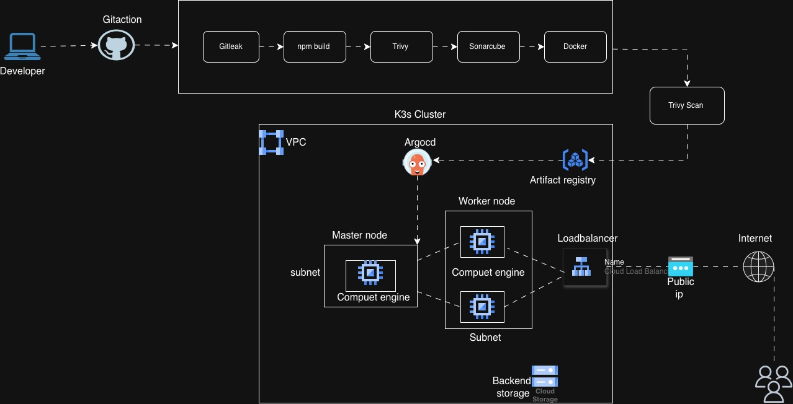

# SimpleBank – Full-Stack Microservices, Docker and Kubernetes Infrastructure

A full-stack banking application built to demonstrate microservices architecture, containerization, infrastructure as code, and Kubernetes deployment concepts on Google Cloud.

The project combines a React and TypeScript frontend, a Node.js/Express API gateway, three Java Spring Boot microservices, and a PostgreSQL database. It also includes Terraform modules for provisioning Google Cloud infrastructure and Kubernetes manifests for application deployment.

## 1. Project Overview

SimpleBank is a banking application sandbox that allows users to:

- Register and log in to a banking account.
- View account balances and account details.
- Deposit demonstration funds.
- Transfer funds between registered accounts.
- View and filter transaction history.
- Review incoming and outgoing transactions.

The project separates banking functionality into independent backend services. The frontend communicates with a Node.js/Express gateway, which routes API requests to the appropriate Spring Boot service.

The application is designed for learning and infrastructure engineering demonstrations. It is not a production banking platform and does not process real financial transactions.

## 2. Architecture



### How the application works

**1. Frontend**

The React application provides the user interface. It is built with TypeScript, Vite, Tailwind CSS, Axios, and Lucide React.

The main application screens are:

- Login and registration.
- Banking dashboard.
- Account balance and deposit management.
- Fund transfer.
- Transaction history and filtering.

**2. API Gateway**

The Node.js/Express server runs on port `3000`.

It provides a single entry point for frontend requests and forwards API calls to the appropriate backend service using the configured service URLs.

**3. User Service**

The User Service is a Spring Boot application running on port `8081`.

It handles user registration, login, and user retrieval.

**4. Account Service**

The Account Service runs on port `8082`.

It handles account creation, account lookup, account numbers, account balances, and balance updates.

**5. Transaction Service**

The Transaction Service runs on port `8083`.

It handles deposits, internal transfers, transaction records, and communication with the Account Service.

**6. PostgreSQL**

PostgreSQL runs on port `5432` and stores the application records.

The database schema is defined in `simplebank/schema.sql` and includes:

- `users`
- `accounts`
- `transactions`

## 3. Technology Stack

| Area | Technology |
|---|---|
| Frontend | React, TypeScript, Vite |
| Styling | Tailwind CSS |
| Frontend API requests | Axios |
| API gateway | Node.js, Express |
| Backend services | Java 21, Spring Boot 3.3.4 |
| Data persistence | Spring Data JPA, Hibernate |
| Database | PostgreSQL 16 |
| Containerization | Docker |
| Local orchestration | Docker Compose |
| Infrastructure as Code | Terraform |
| Cloud provider | Google Cloud Platform |
| Compute infrastructure | Google Compute Engine |
| Container orchestration configuration | Kubernetes manifests, K3s-oriented infrastructure |
| CI/CD and security tooling | GitHub Actions, CodeQL, Gitleaks, Checkov, Trivy, OWASP Dependency-Check |
| Build tools | npm, Maven |

## 4. Repository Structure

```text
gcp-gke-simplebank-gitops/
│
├── .github/
│   └── workflows/
│       ├── docker-image.yml
│       └── qa-engineer-ci-cd.yaml
│
├── Terraform/
│   ├── main.tf
│   ├── providers.tf
│   ├── variables.tf
│   ├── terraform.tfvars
│   └── modules/
│       ├── network/
│       │   ├── main.tf
│       │   ├── variable.tf
│       │   └── output.tf
│       ├── compute/
│       │   ├── main.tf
│       │   ├── variable.tf
│       │   └── output.tf
│       └── firewall/
│           ├── main.tf
│           └── variable.tf
│
├── k8s/
│   ├── app.yaml
│   ├── user-service/
│   │   └── deployment.yaml
│   ├── account-service/
│   │   └── deployment.yaml
│   └── transaction-service/
│       └── deployment.yaml
│
├── simplebank/
│   ├── README.md
│   ├── schema.sql
│   └── backend/
│       ├── user-service/
│       │   ├── Dockerfile
│       │   ├── pom.xml
│       │   └── src/
│       ├── account-service/
│       │   ├── Dockerfile
│       │   ├── pom.xml
│       │   └── src/
│       └── transaction-service/
│           ├── Dockerfile
│           ├── pom.xml
│           └── src/
│
├── src/
│   ├── App.tsx
│   ├── apiConfig.ts
│   ├── main.tsx
│   ├── types.ts
│   └── components/
│       ├── Dashboard.tsx
│       ├── History.tsx
│       ├── Login.tsx
│       ├── Navbar.tsx
│       └── Transfer.tsx
│
├── assets/
├── .dockerignore
├── .env.example
├── .gitignore
├── Dockerfile
├── docker-compose.yml
├── index.html
├── metadata.json
├── package.json
├── package-lock.json
├── server.ts
├── tsconfig.json
└── vite.config.ts
```

## 5. Prerequisites

To run the complete application locally, install:

- Docker Engine or Docker Desktop.
- Docker Compose.
- Git.

For infrastructure provisioning, you will also need:

- A Google Cloud project.
- Google Cloud CLI (`gcloud`).
- Terraform.
- Appropriate Google Cloud permissions.

## 6. Run the Complete Application with Docker Compose

Docker Compose is the recommended way to run the complete application because it builds and starts the frontend/API gateway, all three Java services, and PostgreSQL.

### Step 1: Clone the repository

```bash
git clone https://github.com/smogalloyubio/gcp-gke-simplebank-gitops.git

cd gcp-gke-simplebank-gitops
```

### Step 2: Build and start the application

Run this command from the repository root:

```bash
docker compose up --build -d
```

Docker Compose builds the application images and starts these services:

| Service | Container port | Host port |
|---|---:|---:|
| SimpleBank frontend/API gateway | 3000 | 3000 |
| User Service | 8081 | 8081 |
| Account Service | 8082 | 8082 |
| Transaction Service | 8083 | 8083 |
| PostgreSQL | 5432 | 5432 |

The PostgreSQL container mounts `simplebank/schema.sql` as an initialization script. The script creates the tables and inserts demonstration records when the database is initialized for the first time.

### Step 3: Check running containers

```bash
docker compose ps
```

View application logs:

```bash
docker compose logs -f
```

View an individual service:

```bash
docker compose logs -f simplebank
docker compose logs -f user-service
docker compose logs -f account-service
docker compose logs -f transaction-service
docker compose logs -f postgres
```

### Step 4: Open the application

Navigate to:

```text
http://localhost:3000
```

The React frontend is served by the Node.js application. API requests are routed through the Express server to the backend microservices.

### Step 5: Test the demonstration accounts

The database initialization script provides two demonstration users:

| User | Email | Password |
|---|---|---|
| Sarah Connor | sarah@simplebank.com | password123 |
| John Connor | john@simplebank.com | password123 |

You can use either account to explore the dashboard, deposits, transfers, and transaction history.

### Step 6: Stop the application

Stop the containers:

```bash
docker compose down
```

To remove the PostgreSQL volume and reset the local database:

```bash
docker compose down -v
```

## 7. Build and Run Individual Containers

The repository contains separate Dockerfiles for the frontend/API gateway and each Java service.

### Build the frontend and gateway

From the repository root:

```bash
docker build -t simplebank-app:latest .
```

Run it:

```bash
docker run -d \
  --name simplebank-app \
  -p 3000:3000 \
  simplebank-app:latest
```

### Build the Java microservices

User Service:

```bash
docker build \
  -t simplebank-user-service:latest \
  ./simplebank/backend/user-service
```

Account Service:

```bash
docker build \
  -t simplebank-account-service:latest \
  ./simplebank/backend/account-service
```

Transaction Service:

```bash
docker build \
  -t simplebank-transaction-service:latest \
  ./simplebank/backend/transaction-service
```

These services also require access to PostgreSQL and, for transaction operations, the Account Service.

For the complete working local environment, use Docker Compose instead of starting the containers individually.

## 8. Database Design

The PostgreSQL schema is maintained in:

```text
simplebank/schema.sql
```

### Users table

Stores user information, including:

- User ID.
- First name.
- Last name.
- Email.
- Password.

### Accounts table

Stores banking account information:

- Account ID.
- User ID.
- Account number.
- Account balance.
- Account type.

The `user_id` column references the users table.

### Transactions table

Stores financial activity:

- Transaction ID.
- Account ID.
- Transaction type.
- Transaction amount.
- Transaction status.
- Creation timestamp.
- Transaction description.

The supported transaction types include:

- `DEPOSIT`
- `WITHDRAWAL`
- `TRANSFER_OUT`
- `TRANSFER_IN`

## 9. Terraform – Google Cloud Infrastructure

The Terraform configuration is located in:

```text
Terraform/
```

It uses reusable modules to organize Google Cloud infrastructure provisioning.

### Network module

The network module provisions:

- A custom Google Cloud VPC.
- A subnet using the `10.0.1.0/24` CIDR range.
- A Cloud Router.
- Cloud NAT with automatic public IP allocation.

Cloud NAT provides outbound connectivity for resources without public IP addresses.

### Compute module

The compute module provisions:

- One master virtual machine.
- Two worker virtual machines.
- Debian-based boot disks.
- Network interfaces attached to the custom VPC and subnet.

The master instance receives a public IP address. The worker instances do not receive public IP addresses.

The startup scripts attempt to install K3s on the master and join the workers to the cluster.

### Firewall module

The firewall module defines internal communication rules for the K3s nodes and application-related ports.

### Configure Google Cloud authentication

Authenticate using the Google Cloud CLI:

```bash
gcloud auth login
```

Configure Application Default Credentials:

```bash
gcloud auth application-default login
```

Select your project:

```bash
gcloud config set project YOUR_GCP_PROJECT_ID
```

### Configure Terraform variables

Open:

```text
Terraform/terraform.tfvars
```

Replace the placeholder project ID with your actual Google Cloud project ID.

Review the region, zone, VM names, machine type, and operating system image before provisioning.

### Initialize Terraform

```bash
cd Terraform

terraform init
```

### Validate the configuration

```bash
terraform fmt -recursive

terraform validate
```

### Review the infrastructure plan

```bash
terraform plan
```

### Provision the infrastructure

```bash
terraform apply
```

Review the proposed changes and confirm the operation.

### Destroy the infrastructure

When you no longer need the infrastructure:

```bash
terraform destroy
```

## 10. Kubernetes Deployment Configuration

The repository contains Kubernetes manifests under:

```text
k8s/
```

The manifests define:

- SimpleBank application Deployment and Service.
- User Service Deployment and Service.
- Account Service Deployment and Service.
- Transaction Service Deployment and Service.

The main application manifest specifies:

- One application replica.
- Container port `3000`.
- Production Node.js environment.
- Readiness probe.
- Liveness probe.
- ClusterIP Service exposing port `80` and forwarding to port `3000`.

### Validate the manifests

From the repository root:

```bash
kubectl apply --dry-run=client -f k8s/app.yaml
```

Validate the other manifests:

```bash
kubectl apply --dry-run=client -f k8s/user-service/deployment.yaml

kubectl apply --dry-run=client -f k8s/account-service/deployment.yaml

kubectl apply --dry-run=client -f k8s/transaction-service/deployment.yaml
```

### Apply the manifests

After configuring valid container image references:

```bash
kubectl apply -f k8s/
```

Check deployments and services:

```bash
kubectl get deployments

kubectl get pods

kubectl get services
```

Inspect an application deployment:

```bash
kubectl describe deployment simplebank-app
```

View application logs:

```bash
kubectl logs deployment/simplebank-app
```

## 11. GitHub Actions – CI and Security Checks

The repository contains GitHub Actions workflows under:

```text
.github/workflows/
```

The `qa-engineer-ci-cd.yaml` workflow is configured to run on pushes and pull requests targeting the `qa-engineer` branch.

It defines the following jobs:

| Job | Purpose |
|---|---|
| Build | Compile the Java code using Maven |
| Test | Execute Maven tests after the build |
| Security Scans | Run CodeQL, Gitleaks, and Checkov |
| Dependency and Container Scan | Run Trivy filesystem and configuration scanning |
| Dependency Check | Run OWASP Dependency-Check |


The Docker Compose configuration also supplies the following service URLs to the gateway:

```text
USER_SERVICE_URL=http://user-service:8081
ACCOUNT_SERVICE_URL=http://account-service:8082
TRANSACTION_SERVICE_URL=http://transaction-service:8083
```

## 14. Project Learning Objectives

This project provides practical experience with:

- Designing a modular microservices application.
- Connecting React applications to REST APIs.
- Building Java Spring Boot services.
- Managing PostgreSQL persistence.
- Containerizing frontend and backend services.
- Orchestrating multi-container applications with Docker Compose.
- Designing reusable Terraform modules.
- Provisioning Google Cloud networking and compute infrastructure.
- Understanding Kubernetes Deployments and Services.
- Building security checks into GitHub Actions workflows.
- Identifying the operational requirements of a cloud-native application.

